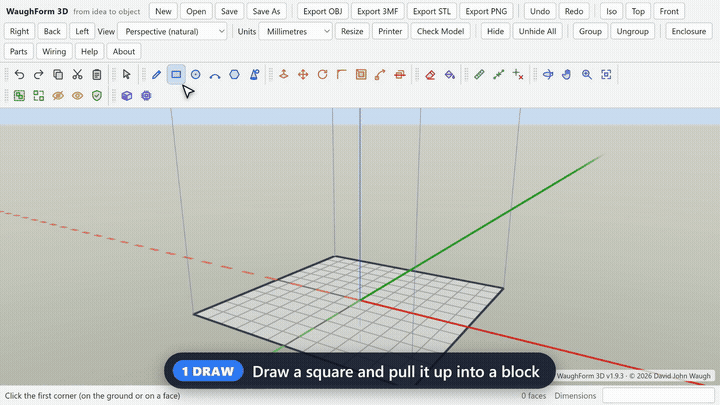
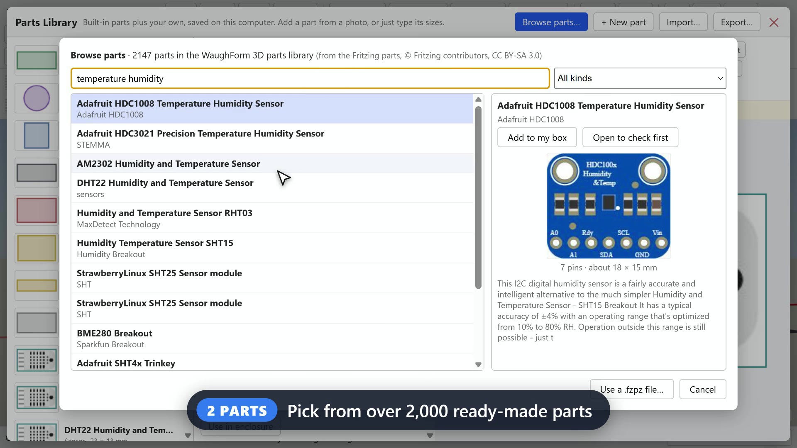
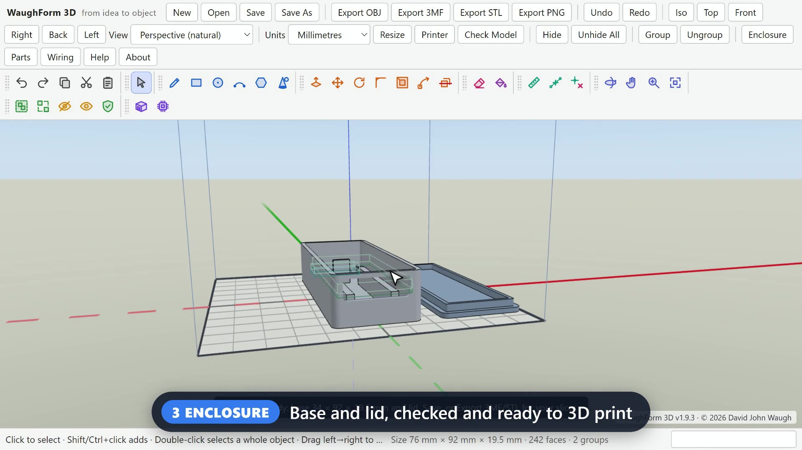
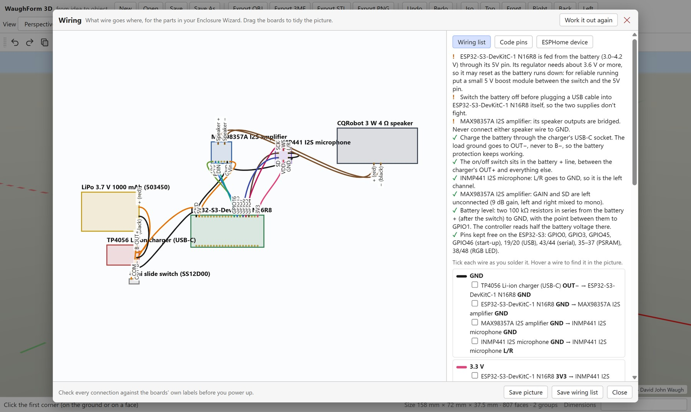
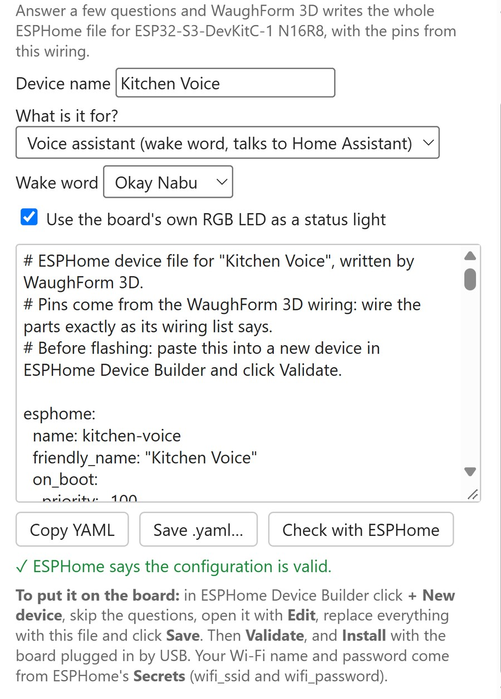

# WaughForm 3D: from idea to object

**Draw it, add the parts, and get the box, the wiring and the code.**

WaughForm 3D is a free Windows app for designing things to 3D print, especially boxes for your electronics projects. You draw parts the way you would in SketchUp. Or you pick your electronic parts from a built-in library of over 2,000, and WaughForm 3D designs a printable case that fits them. It also shows you which wire goes where and writes the [ESPHome](https://esphome.io) code for an ESP32 board.

Everything runs on your own computer and works offline.



▶ **[Watch the 35-second demo video](docs/WaughForm-3D-demo.mp4)**

## Download

Get the latest version from the **[Releases page](../../releases/latest)**:

- **WaughForm 3D Setup x.y.z.exe**: installs the app with a Start menu and desktop shortcut.
- **WaughForm 3D Portable x.y.z.exe**: just double-click it; nothing is installed (works from a USB stick).
- **Web version**: `WaughForm_3D.html` plus `parts-library.json`; open the HTML file in Chrome or Edge.

It needs Windows 10 or 11 (64-bit). The app isn't code-signed, so the first time you run it Windows may show *"Windows protected your PC"*: click **More info**, then **Run anyway**.

The illustrated **User Manual (PDF)** comes with every release.

## What it does

| | |
|---|---|
|  | **Parts**: search over 2,000 ready-made parts by name or by what they do ("gyroscope", "air quality", "screen"). Each comes with its pins, size and picture. You can also add your own parts from a photo or a Fritzing `.fzpz` file. |
|  | **Enclosure Wizard**: pick your parts and a style, and it lays them out and builds a base and lid with the right holes, mounts and clearances. It checks the result fits your printer and is ready to print. |
|  | **Wiring**: a diagram and a tick-off list of every connection, worked out from the parts' pins. |
|  | **Code**: writes a complete ESPHome YAML file for the ESP32 board, using the pins from the wiring. Add simple rules ("light red above 28 °C"), or describe what you want and let an AI add it (optional, with your own key). Then *Send to ESPHome* puts it straight into ESPHome Device Builder. |

**Drawing tools (SketchUp-style):** Line, Rectangle, Circle, Arc, Polygon, Push/Pull, Move, Rotate, Offset, Follow Me, Round/Chamfer, Slice, Tape Measure with guides, Paint, 3D shapes (ball, cone, cylinder, pyramid), Copy/Paste and Undo. Shortcut keys match SketchUp. *Check Model* finds holes, gaps and floating pieces before you print.

**Export:** STL, 3MF, OBJ and PNG.

## Building it yourself

The whole app is one file, [`WaughForm_3D.html`](WaughForm_3D.html). The Windows app wraps it with [Electron](https://www.electronjs.org/). See [`desktop/HOW TO BUILD.txt`](desktop/HOW%20TO%20BUILD.txt). In short, with Node.js installed:

```
cd desktop
npm install
npm run dist
```

To try it without building, open `WaughForm_3D.html` in a browser. For the parts library, put `desktop/parts-library.json` next to it.

## Licence

WaughForm 3D is © 2026 David John Waugh. It is free software: you can use, share and change it under the **[GNU General Public License v3](LICENSE)** or any later version. It comes with no warranty.

It includes the following, each under its own licence (see [THIRD-PARTY-NOTICES.md](THIRD-PARTY-NOTICES.md)):

- the [Manifold](https://github.com/elalish/manifold) geometry library, Apache License 2.0;
- the [Anthropic TypeScript SDK](https://github.com/anthropics/anthropic-sdk-typescript), Apache License 2.0;
- a parts library made from the [Fritzing parts](https://github.com/fritzing/fritzing-parts), © Fritzing contributors, CC BY-SA 3.0.

## Problems and ideas

Please open an [issue](../../issues). Say which version you have: click **About** in the app.
